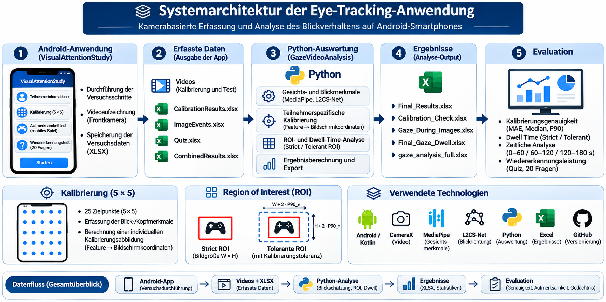

# VisualAttentionStudy

**Android-Anwendung zur kamerabasierten Erfassung und Analyse des Blickverhaltens im Rahmen einer Bachelorarbeit**

## Projektübersicht

Dieses Projekt entstand im Rahmen meiner Bachelorarbeit im Studiengang Biomedizinische Technik an der htw saar.

## Systemarchitektur

Die folgende Abbildung zeigt den Aufbau des entwickelten Systems sowie den Datenfluss zwischen der Android-Anwendung und der nachgelagerten Python-Auswertung.




**Titel der Bachelorarbeit:**

*Kamerabasiertes Eye-Tracking zur Blickdatenanalyse auf Android-Smartphones am Beispiel eines mobilen Spiels*

Ziel der Arbeit ist die Entwicklung und Evaluation eines prototypischen Systems zur kamerabasierten Erfassung und Analyse des Blickverhaltens auf Android-Smartphones. Dabei wird untersucht, inwieweit sich die integrierte Frontkamera eines Smartphones zur Erfassung von Blickdaten während einer visuellen Aufgabe einsetzen lässt.

## Funktionsumfang der Android-Anwendung

Die Android-Anwendung umfasst mehrere aufeinanderfolgende Schritte:

1. **Teilnehmerinformationen:** Erfassung grundlegender Angaben zur Versuchsperson.
2. **Kalibrierung:** Durchführung einer Kalibrierung mit 25 Zielpositionen in einem 5 × 5-Raster.
3. **Testinstruktion:** Darstellung der Anweisungen für die Versuchsdurchführung.
4. **Mobiles Spiel:** Durchführung eines visuellen Aufmerksamkeitstests mit eingeblendeten Bildern.
5. **Wiedererkennungstest:** Beantwortung von 20 Fragen zur Wiedererkennung zuvor präsentierter Bilder.

Während der Kalibrierung und des mobilen Spiels werden mithilfe der Frontkamera Videoaufnahmen erstellt.

## Technische Umsetzung

Die Android-Anwendung wurde mit **Kotlin** in **Android Studio** entwickelt.

Verwendete Technologien:

- Kotlin
- Android SDK
- CameraX
- Gradle
- Git und GitHub

Die Anwendung übernimmt die Durchführung der Versuche, die Videoaufzeichnung sowie die strukturierte Speicherung der Versuchsdaten.

## Blickdatenanalyse

Die eigentliche Blickschätzung erfolgt nicht direkt auf dem Android-Smartphone, sondern nachträglich in einer separaten Python-Auswertungspipeline.

Hierbei werden unter anderem folgende Verfahren eingesetzt:

- **MediaPipe:** Extraktion von Gesichts- und Augenmerkmalen.
- **L2CS-Net:** Schätzung der Blickrichtung.
- **Teilnehmerspezifische Kalibrierung:** Umrechnung ausgewählter Blickmerkmale in Bildschirmkoordinaten.
- **Region of Interest (ROI):** Untersuchung, ob geschätzte Blickpositionen innerhalb definierter Bildbereiche liegen.
- **Dwell-Time-Analyse:** Berechnung blickbasierter Aufenthaltszeiten innerhalb der Bildbereiche.

Die Python-Auswertung ist nicht Bestandteil dieses Android-Repositories.
## Technische Herausforderungen und Lösungsansätze

### 1. Kamerabasierte Blickschätzung und Kalibrierungsgenauigkeit

Eine wesentliche Herausforderung bestand darin, aus den mit der Smartphone-Frontkamera aufgezeichneten Videos geeignete Merkmale zur Schätzung der Blickposition auf dem Bildschirm zu gewinnen.

Hierzu wurde eine teilnehmerspezifische Kalibrierung mit 25 Zielpositionen in einem 5 × 5-Raster eingesetzt. Die extrahierten Blickmerkmale wurden den bekannten Bildschirmkoordinaten zugeordnet, um individuelle Kalibrierungsabbildungen zu bestimmen.

Die Genauigkeit der Blickschätzung wurde anhand verschiedener Fehlerkennzahlen, darunter Mean Absolute Error (MAE), Median und 90. Perzentil (P90), untersucht.

### 2. Vergleich von MediaPipe und L2CS-Net

Im Rahmen der Python-basierten Videoanalyse wurden unterschiedliche Merkmale von MediaPipe und L2CS-Net hinsichtlich ihrer Eignung zur horizontalen und vertikalen Blickschätzung verglichen.

Die Auswertung zeigte, dass die untersuchten Merkmale je nach Koordinatenrichtung unterschiedliche Eigenschaften aufweisen.

Auf Grundlage der Kalibrierungsanalyse wurde für die horizontale Blickschätzung das MediaPipe-Merkmal *Both Eyes X* und für die vertikale Blickschätzung die *true-Pitch*-Komponente von L2CS-Net verwendet.

Dieser Ansatz ermöglicht die getrennte Modellierung der horizontalen und vertikalen Blickkoordinaten.

### 3. Berücksichtigung von Kalibrierungsabweichungen bei der ROI-Analyse

Eine weitere Herausforderung bestand darin, geschätzte Blickpositionen den während des mobilen Spiels eingeblendeten Bildbereichen zuzuordnen.

Dazu wurden zwei Auswertungsvarianten implementiert:

- **Strict ROI:** Berücksichtigung ausschließlich der tatsächlichen Bildgrenzen.
- **Tolerant ROI:** Erweiterung der Bildgrenzen anhand der teilnehmerspezifischen P90-Kalibrierungsabweichungen in horizontaler und vertikaler Richtung.

Für beide Varianten wurden blickbasierte Aufenthaltszeiten (*Dwell Time*) berechnet.

Der Vergleich ermöglicht es, die Auswirkungen der Kalibrierungsunsicherheit auf die Zuordnung der geschätzten Blickpositionen zu den Bildbereichen zu untersuchen.

### 4. Trennung von Datenerfassung und Blickdatenanalyse

Die Datenerfassung und die Blickdatenanalyse wurden als getrennte Verarbeitungsschritte umgesetzt.

Die Android-Anwendung übernimmt die Versuchsdurchführung, die Videoaufzeichnung mit CameraX sowie die Speicherung der zugehörigen Versuchsdaten.

Die anschließende Blickschätzung und Auswertung erfolgen offline mithilfe einer separaten Python-Pipeline.

Diese Trennung ermöglicht es, unterschiedliche Verfahren zur Blickschätzung zu vergleichen und die Auswertungsmethodik weiterzuentwickeln, ohne die Android-Anwendung für jede Analyseänderung anpassen zu müssen.

## Projektarchitektur

Android-Anwendung → Videoaufzeichnung und Versuchsdaten → Python-Auswertung → Blickkoordinaten und ROI-Analyse → Ergebnisdateien

## Installation und Ausführung

### Voraussetzungen

Für die Installation und Ausführung der Android-Anwendung werden folgende Komponenten benötigt:

- Android Studio
- Ein kompatibles Android-Smartphone mit Frontkamera
- Eine USB-Verbindung oder eine drahtlose Debugging-Verbindung
- Eine Internetverbindung für den erstmaligen Download der Projektabhängigkeiten

### Projekt herunterladen

Das Repository kann über Git geklont werden:

```bash
git clone https://github.com/abdulhtwsaar/VisualAttentionStudy.git
```

Alternativ kann das Projekt über GitHub als ZIP-Datei heruntergeladen werden.

### Anwendung starten

1. Android Studio öffnen.
2. Das heruntergeladene Projekt über **Open** auswählen.
3. Die Gradle-Synchronisierung abwarten.
4. Ein Android-Smartphone verbinden und gegebenenfalls USB-Debugging aktivieren.
5. Das Smartphone als Zielgerät auswählen.
6. Die Anwendung über **Run** installieren und starten.
7. Die erforderlichen Kameraberechtigungen erteilen.

### Durchführung

Nach dem Start der Anwendung können die Teilnehmerinformationen eingegeben und die Kalibrierung durchgeführt werden.

Anschließend folgen der visuelle Aufmerksamkeitstest und der Wiedererkennungstest.

Die während der Versuchsdurchführung erfassten Daten werden lokal auf dem Smartphone gespeichert.

### Hinweis zur Auswertung

Die Android-Anwendung dient der Durchführung der Versuche und der Datenerfassung.

Die eigentliche Blickschätzung erfolgt anschließend offline über eine separate Python-Auswertungspipeline mit MediaPipe und L2CS-Net.

Diese Python-Pipeline ist nicht Bestandteil dieses GitHub-Repositories.

## Wissenschaftlicher Kontext

Das Projekt dient der Untersuchung der technischen Möglichkeiten und Grenzen eines kamerabasierten Eye-Tracking-Ansatzes auf handelsüblichen Android-Smartphones.

Die Ergebnisse sind als Evaluation eines Forschungsprototyps zu verstehen. Das System stellt kein medizinisch validiertes Diagnoseverfahren dar.

## Autor

**Abdul Majid Alabrash**

Bachelorstudiengang Biomedizinische Technik  
htw saar – Hochschule für Technik und Wirtschaft des Saarlandes

## Hinweis

Dieses Repository enthält den Quellcode der im Rahmen der Bachelorarbeit entwickelten Android-Anwendung. Die separate Python-Auswertungspipeline und die erhobenen personenbezogenen Versuchsdaten sind nicht enthalten.
